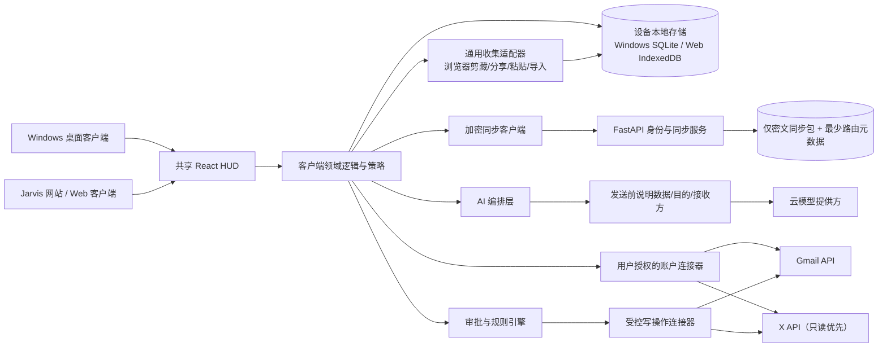
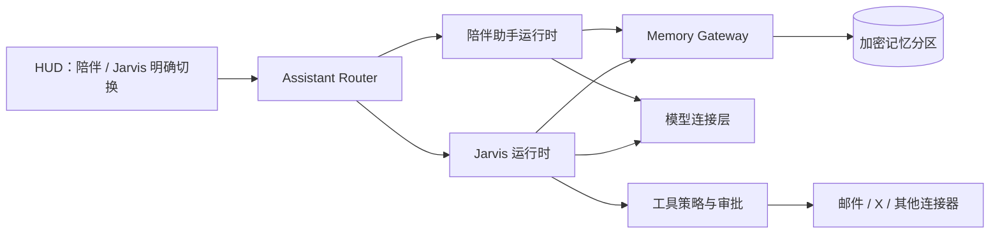

# Jarvis 系统架构

**状态：** Proposed architecture  
**版本：** 0.1  
**更新：** 2026-11-06

## 架构原则

1. 本地优先并支持可信设备；跨设备同步默认端到端加密，服务端不持有内容明文。
2. UI、领域逻辑、存储、外部连接和模型调用分层；原型可以单体，边界先清楚。
3. LLM 输出是建议，不是权限；所有外部写操作由策略层和审批服务强制把关。
4. 连接器可替换；模型提供方可替换；统一数据模型保留原始来源信息。
5. 不为“看起来像 Agent”而引入自主执行、常驻监听或过早的微服务。

## 建议演进栈

### 阶段 A：视觉与交互原型

- 单文件 HTML/CSS/JS 用于无环境预览。
- 纯模拟数据，不加载外部字体、图片、SDK 或第三方脚本。
- 用 CSS/SVG/Canvas 实现原创 HUD 核心；DOM 实现表单、列表和审批，保留键盘与读屏可用性。

### 阶段 B：多端本地优先版（目标已确认，协议细节待设计）

- **客户端：** React + Vite + TypeScript 共用 HUD；Windows 提供可安装桌面体验，Web 端支持 Jarvis 账户登录。先评估 PWA，再决定是否使用 Tauri/Electron 封装，避免过早维护两套 UI。
- **本地数据：** Windows 本地 SQLite/FTS5；Web 端 IndexedDB/浏览器存储；关键资料本地可用。
- **服务端：** Python 3.11+ + FastAPI + Pydantic，负责 Jarvis 身份、设备会话、密文同步包转发和最少必要审计元数据。
- **同步：** 采用端到端加密；客户端加/解密正文和附件，服务端只保存密文及完成路由/去重所需元数据。密钥恢复、设备撤销、密钥轮换和离线冲突合并仍需设计。
- **数据库/索引：** 服务端 Postgres 存用户/设备记录、同步版本和密文；正文全文索引留在设备本地。服务端不得建立可读邮件/帖文内容索引。
- **连接器：** Gmail 官方 API + OAuth；X 官方 API + 用户 OAuth；HTTP 客户端使用 `httpx`。
- **统一收集：** Gmail/X 在授权和 API 可行时提供连接器；浏览器用剪藏扩展/分享入口；微信、小红书和其他应用优先使用系统分享、复制粘贴、URL/文件导入。每条记录进入本地 Capture Inbox 后加密同步。
- **任务：** 由客户端控制同步时机与范围；可见进度、成本和错误。后续再考虑定时任务。
- OAuth refresh token 存在设备安全存储（Windows Credential Manager 或浏览器设备密钥加密存储），不进入跨设备同步包。
- Gmail/X 接入前完成设备信任、OAuth scope、备份/删除、离线冲突解决策略。

### 阶段 C：部署扩展与服务能力

跨设备账户和网页登录已成为目标，因此身份/加密同步服务进入规划；部署地区、账户恢复和元数据保留策略仍需确认。端到端加密只保护 Jarvis 同步存储；当用户允许把选定内容发送给云模型时，模型提供方仍会接收这些明文输入，必须在请求前说明数据字段、接收方与目的。

## Windows 与 Web 的执行边界（设计待验证）

当前代码是 Windows/Python 本机原型：本地 HTTP 只能由同机客户端访问，明文 SQLite 只可存合成资料。它既不是网络服务，也不能因为用户在其他设备打开网站就被直接访问。浏览器不能直接运行这一 Python 本地服务。

未来的 Windows 桌面端可在设备上运行 Python 领域服务和经验证的加密存储；未来 Web 端需要在浏览器实现相应的数据解密、搜索与权限检查，并通过 IndexedDB 等保存本地密文。两端可以共享版本化数据和行为合同及测试用例，但不能假设共享同一段 Python 实现。是否采用 TypeScript 客户端、WebAssembly 或其他方案尚未定案。

跨设备服务器只提供身份/设备注册与密文包存取，不接收用于后台运行 Jarvis 的正文密钥。若某项功能要求服务端看到明文、保存 Gmail 令牌或调用模型，必须重新解释其与端到端加密目标的冲突并经用户单独确认，不能悄悄把本机服务迁到云端。Web 版使用由服务器下发的脚本，因此部署供应链或恶意脚本可能窃取解锁后的内容和密钥；端到端加密不能消除这一风险。设备加入、恢复和撤销需要单独设计并检验。

Gmail 等连接器能否在浏览器安全、稳定地执行取决于供应商的 OAuth、CORS 和浏览器环境；不能假定 Python 桌面连接器能直接搬到 Web。可先由用户授权的 Windows 设备同步密文到其他设备，Web 的独立连接能力另行验证。微信/X 的可用范围也需逐平台确认。

## 模块图

## 分层职责

- **HUD UI：** 共享桌面/Web 组件、搜索、编辑、审批确认；设备端不把长期令牌暴露给页面脚本。
- **身份/同步服务：** Jarvis 登录、可信设备管理、加密同步包转发、请求校验和同步状态；正文/附件内容保持端到端加密。
- **客户端领域服务：** 邮件 triage、内容归档、知识检索、待办关联、动作策略；确定数据方案后决定哪些逻辑放在设备端或服务端。
- **收集适配器：** 浏览器剪藏、系统分享、全局快捷键/剪贴板和拖放导入；每条捕获明确标记来源和用户选择的范围。
- **连接器：** 分别实现 Gmail/X 的 OAuth、分页、重试、限流、字段映射；微信/小红书按官方 API 可用范围或用户主动分享方式支持。
- **AI 适配层：** 摘要、分类、回复草稿、知识问答；结构化 JSON 输出、超时、成本计量、来源引用。
- **审批服务：** 生成不可变动作快照、批准/拒绝/过期、重验动作内容、执行幂等键、审计。
- **仓储层：** SQL 查询、事务、全文搜索、同步游标、审计事件。

## 核心数据实体

| 实体 | 关键字段 | 说明 |
|---|---|---|
| `Connection` | `provider`, `account_id`, `scopes`, `status`, `token_ref` | 令牌值保存在 OS 凭据库；数据库只存引用 |
| `SourceItem` | `id`, `provider`, `external_id`, `kind`, `title`, `body`, `url`, `author`, `occurred_at`, `synced_at` | 邮件、X 帖文、文档的统一索引 |
| `CaptureItem` | `id`, `source_app`, `capture_method`, `url`, `selected_text`, `created_at`, `state` | 从应用/网页主动保存的内容；原文范围由用户选择 |
| `SourceState` | `source_item_id`, `is_read`, `is_liked`, `is_bookmarked`, `labels_json` | 来自 provider 的状态只读镜像，明确同步时间 |
| `Note` | `id`, `title`, `body`, `created_at`, `updated_at` | 用户知识条目 |
| `Tag` / `ItemTag` | `tag_id`, `item_id`, `origin` | `origin=jarvis` 表示本地标签，不回写来源 |
| `Todo` | `id`, `title`, `description`, `status`, `priority`, `due_at` | 待办事项 |
| `TodoSource` | `todo_id`, `source_item_id`, `relation` | 来源可多对多关联 |
| `AISuggestion` | `id`, `kind`, `source_id`, `payload`, `model`, `confidence`, `state` | AI 输出的提议与状态 |
| `ActionProposal` | `id`, `kind`, `target_id`, `payload_hash`, `payload`, `status`, `expires_at`, `approved_at` | 写操作待审批；批准绑定 payload hash |
| `AuditEvent` | `id`, `action_id`, `event`, `result`, `occurred_at` | 仅追加记录批准与执行结果 |
| `SyncCursor` | `provider`, `resource`, `cursor`, `last_success_at` | 增量同步和断点恢复 |

## 安全与权限边界

- 按每个客户端/设备申请最小 Gmail/X scope；草稿保存和标签管理等写权限按功能另行启用。
- OAuth 使用 Authorization Code + PKCE；redirect URI 精确匹配；state 防 CSRF。Jarvis 网站账户登录与 Gmail/X 账户授权分开。
- UI 通过服务层请求；refresh token 使用 OS 安全存储，浏览器端以短期会话和安全 cookie 为优先。
- 每个 connector 使用明确 allowlist；绝不让模型构造任意 URL 或直接发 HTTP 请求。
- 执行前重新检查授权仍有效、目标对象存在、动作未过期、payload hash 未改变。
- 发送邮件：必须人工确认完整收件人/主题/正文；拒绝批量发送与自动发送。
- 删除邮件：MVP 只允许单封移入垃圾桶，二次确认；永久删除不开放。
- 自动规则只能作用于用户明确启用的可逆整理动作；创建规则先预览目标集，提供暂停/撤销/日志。不得自动发送、永久删除或发帖。
- X 写操作：首发不开放。未来如发帖，逐条展示最终文本/媒体/账号并明确批准。
- 邮件和帖子正文作为不可信数据输入；提示注入不能改变系统策略或授权。
- 审计日志不记录完整邮件正文、refresh token 或 API key。
- Sync API 收到客户端密文后不做服务器端内容解密、全文索引或模型处理。

## 数据同步与 AI 数据流

1. 用户手动选择来源与同步范围。
2. 同步任务按游标分页获取用户授权数据，映射至 `SourceItem`，以 `(provider, external_id)` 去重；通用分享/剪藏生成 `CaptureItem`。
3. 清理 HTML、识别引用/签名；保留原文与来源 URL；不覆盖用户自有笔记。
4. 用户确认后，客户端将最小必要内容明文发送给所选云模型；模型返回结构化摘要、标签或草稿及引用来源。同步服务器不参与模型处理。
5. 输出写入 `AISuggestion`，呈现在 HUD；用户可接受、编辑或拒绝。
6. 若产生外部写操作，创建 `ActionProposal`，经过人工批准后才由 write connector 执行。

语音路径：用户按住/按下指定按键开始录音，再次松开/按下停止；界面显示麦克风使用状态和识别文本预览。播报提供静音/打断。云端 ASR/TTS 若会传输音频，首次启用和对应服务变更时需清楚告知；不允许后台常驻监听。

## 失败与可观测性

- 对 401 提供重新授权入口；429 遵守 `Retry-After`；网络错误采用退避重试。
- 同步失败保留上次成功数据和游标；提供部分成功状态，不回滚无关本地更改。
- 每次同步记录来源、范围、返回数量、耗时、成本估算和错误码；不记录敏感正文。
- 所有异步任务可取消；用户可以看到正在同步/分析/等待审批/失败状态。

## 双助手与连续性记忆架构增补

### 组件边界

- **Assistant Router** 根据当前 UI 选择的助手身份建立会话上下文，不能由模型自行切换身份或扩大权限。
- **陪伴助手运行时** 只负责对话、情绪整理和获准的陪伴记忆；没有邮件、社交私信或外部发送工具。
- **Jarvis 运行时** 负责任务、邮件、知识库和连接器；外部写操作经工具策略与人工审批。
- **Memory Gateway** 是两个运行时访问记忆的唯一入口。它根据助手 ID、会话、记忆分区授权和用户显式共享记录过滤结果；模型不能直连数据库。
- **加密记忆分区** 至少分为个人共享资料、陪伴记忆、工作/项目记忆、会话原文四类。默认只给每个助手开放其所属分区。

### 连续性记忆写入和读取

1. 当前对话结束或上下文接近上限时，客户端生成一份待审阅的 Continuity Snapshot：近期话题、未完成问题、用户确认的变化和候选记忆来源。
2. 用户可逐条接受、修改、拒绝或标为“只在本次会话有效”；未经确认的候选项不能成为长期陪伴记忆。
3. 新会话由 Memory Gateway 按当前话题召回少量记忆，并附带来源 ID、时间、记忆类型和置信度；低置信度不自动注入，先向用户确认。
4. 模型输出标明是用户原话、系统摘要还是推断；用户纠正时保留来源记录并更新摘要，不能反向改写原始消息。
5. 切换模型时重用用户确认的助手设定和记忆数据，但新增模型版本记录；界面提示行为可能变化，不宣称同一模型人格或主观体验连续。

### 数据表增补

> 字段口径以[细化方案 §3.3](PLAN.md) 的单表定义为准：`MemoryItem` 用 `namespace + visible[]`、`ContinuitySnapshot` 用 `topics/open/status`、`ActionProposal` 用 `payloadHash`。原型 `preview.html`（v0.3）已按该口径实现，后端建表时沿用同一命名，避免两套字段。

| 实体 | 关键字段 | 约束 |
|---|---|---|
| `AssistantProfile` | `assistant_id`, `role`, `persona_version`, `model_provider`, `model_id` | 陪伴与 Jarvis 使用不同身份/权限配置 |
| `MemoryNamespace` | `namespace_id`, `owner_id`, `kind`, `encrypted_key_ref` | 分区级加密和授权 |
| `MemoryItem` | `id`, `namespace_id`, `content_ciphertext`, `source_refs`, `confidence`, `user_approved_at`, `expires_at`, `forgotten_at` | 每条记忆可追溯、可更正、可删除 |
| `MemoryAccessGrant` | `from_assistant`, `to_assistant`, `namespace_id`, `item_id`, `granted_at`, `revoked_at` | 跨助手共享须用户明确批准 |
| `ContinuitySnapshot` | `id`, `assistant_id`, `conversation_id`, `snapshot_ciphertext`, `source_refs`, `status`, `created_at` | 仅用于承接会话，可审阅和撤回 |
| `MemoryAuditEvent` | `assistant_id`, `memory_id`, `event`, `timestamp` | 记录读取、创建、修改、删除和分享，不存明文内容 |

### 首版非功能要求

- 陪伴助手的模型请求不包含工作记忆或外部连接器内容；Jarvis 也不包含陪伴记忆，除非用户明确分享指定条目。
- 删除或撤权必须同步清理本地索引、续聊快照和其他已授权设备上的副本；离线设备下次上线先处理撤权/删除墓碑，再开放新同步。
- 原文、摘要、向量索引分别有生命周期；删除源会话时，关联摘要与索引按用户选择一并删除或保留为已脱离来源的条目。
- 端到端同步服务只保存密文及必要路由元数据，不持有记忆明文检索索引。

实现顺序和当前待确认的首版优先级见[项目日志](PROJECT_LOG.md)。
