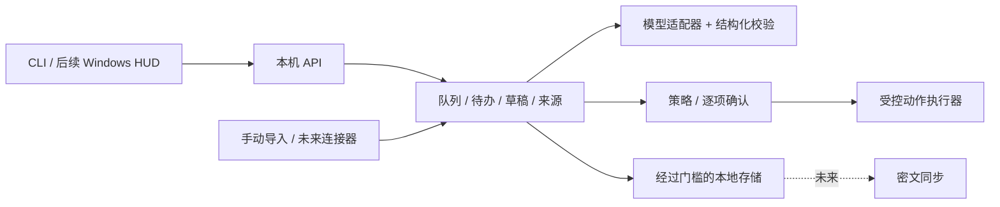

# Jarvis 独立架构与产品审视（2026-11-14）

## 判断与边界

Jarvis 的目标可概括为**个人信息与行动中枢**：将分散信息汇入可追溯工作台，给出有依据的建议，由用户决定是否形成待办、草稿或外部动作。电影 HUD 和按键语音是交互层；微信/X、邮件、同步与助手是不同的连接和权限问题。陪伴模式按用户要求冻结，不是本阶段验收内容。

这是有价值但范围很大的长期目标。目前代码和评测证明了**可供研发验证的虚构数据原型**，还没有证明真实用户的日常价值、真实资料安全或端到端产品可用性。当前最大风险是系统基础设施不断扩张，却缺少可反复体验并得到反馈的单人工作流；另一个风险是把安全原型与“已经安全”混为一谈。

本审视基于当前仓库、合成测试和现有评测记录，不包含用户访谈、真实账号测试、第三方安全审计或生产负载测量。结论属于工程判断，不是独立安全认证。

## 当前证据和差距

| 层 | 可复用证据 | 尚未证明 |
|---|---|---|
| 业务 | 虚构资料的邮件、待办、知识、审批等本地服务与 HTTP；M1 从样本到建议/人工决定/待办草稿 | 真实邮箱、真实用户需求契合度、外发与未知结果核对 |
| AI | 53 条原集、20 条留出集、规则与本地模型对照；原集模型分类 81.1%、留出集 85%，证据与注入检查有记录 | 对真实邮件泛化、独立双人标注、噪声/优先级质量、稳定的总结与草稿效果。样本量小且数据生成/规则有同源偏差 |
| 本地存储 | 显式虚构模式、可选 DPAPI 实验 vault、备份与同机恢复、事务和并发检查 | 驱动 G1、真实数据加密安全、跨设备恢复、独立安全评审、可控数据迁移 |
| 完整性 | M1 未锚定链、快照 HMAC、实验签名 checkpoint/outbox | 备份 `audit.log` 仍明文；可信最新水位、正式密钥管理、epoch 接受和远端真实性 |
| 交付 | Windows 本机离线环境可重建，本轮完整回归为 66 功能项和 1 诊断项 | 受限 runner 一致可用、独立机器重建、持续 CI、正式桌面安装和支持 |
| 界面 | 电影 HUD 可视化意图和 API 雏形 | HUD 与业务打通、可读性/键盘/语音测试、用户任务完成率 |

`driver_provenance` 诊断运行成功并不意味着 G1 关闭。测试数衡量执行范围，不能代替安全审计、真实数据评测或用户验收。历史文档的阶段结果以各自日期为准；当前状态见 [CURRENT_STATUS](CURRENT_STATUS.md)。

## 优先问题

1. **先证明用户闭环。** 邮件和待办是用户确认的第一优先级。以一批虚构邮件演练一天的工作：看到队列、检查来源、编辑建议、建立待办或草稿、撤销并追踪结果。记录完成时间、修改率、漏检和错误成本；在可用性不明时不扩张连接器或 HUD 动效。
2. **安全路线与产品验证解耦。** 继续严格禁止真实资料进入未获批准的存储，但可并行推进无账号的合成数据界面与评测；不必等待密钥系统全部完善才让用户体验流程。可用性演示不能声称真实数据安全。
3. **明确 agent 边界。** 首版应是有来源的建议与受控动作工作流，不是无边界自主执行器。来源内容当作不可信输入，模型无连接器凭据；动作权限、用户批准和结果核验由确定性代码控制。外部发送/发布/删除逐项批准，失败或超时进入未知状态并先核对。
4. **用任务指标驱动 AI。** 将分类拆成重要信息漏检、待办抽取、草稿可编辑性和证据支持等任务；保留逐例错误，建立独立标注与隔离留出集。逐字引用只证明片段存在，不能证明摘要的语义结论被支持。小样本的注入召回不能当全面防御。
5. **压缩基础设施分叉。** 先固定模块化单体：本机领域核心、明确数据模型、模型接口、审批策略和只读连接器接口；旧探针保留到覆盖矩阵证明可迁移再删除。不要同时自建完整同步、长期记忆、多个 agent 编排和多平台自动化。
6. **降低运维复杂度。** 当前解释器、轮换、DPAPI、恢复码、外部水位和桶锁需要一套真正能演练的恢复流程。不要增加新的长期密钥或数据库依赖，除非有明确故障模型和用户可执行的恢复步骤。Python 内存清零、系统分页和日志泄露仍未解决。

## 建议的目标结构

领域层负责状态和事务，usecase 编排可追踪流程；模型负责提出建议，策略和执行器不由模型决定权限。多设备同步与浏览器密钥是独立后续设计，不能因为打算支持网站登录就默认明文上传。网站独立使用和设备离线时的解密行为仍需产品决策。

## 重新排序后的交付建议

| 顺序 | 交付 | 可核对的退出条件 |
|---|---|---|
| A：现在 | 稳定本机虚构演示 + 安全状态可见 | 非开发者能在 Windows 按文档启动，完成至少一条邮件到待办/草稿流程；失败、来源、修改和撤销可见；不访问真实账号 |
| B：并行 | 存储/恢复可信底座与清晰风险 | 驱动来源和许可证证据、独立评审、异机恢复、真实资料入口隔离、性能及发布权限证据各自可追溯；失败保持关闭 |
| C：AI 质量 | 以独立标注合成集和任务级指标评估 | 报告漏检、误报、证据支持、人工修改、结构化失败、延迟；模型与规则和无模型基线对照，阈值提前约定 |
| D：授权试用 | 用户明确连接 Gmail 只读 | 各项存储/恢复/隐私门槛及撤权验证完成；范围和历史覆盖真实可见；不自动外发 |
| E：扩展 | 逐项批准外发，之后多设备和 X | 对每种来源单独验证权限、成本、稳定性、撤权与未知结果处理；不承诺微信/X 全量历史 |

这些是建议顺序，不代表用户放弃 Windows、网站、多设备、HUD 或按键语音。R2、真实账号及任何内容出站仍需要明确连接和授权。用户是否优先看到一个合成 HUD 工作流，或先完成存储 G1 独立评审，可作为接下来产品排期决策；不影响当前本地无账号验证。

## 本轮额外发现

M1 演示入口之前只覆盖 `JARVIS_DATA_DIR`，仍可能继承 vault/适配器变量而指向既有库；本轮改为遇到冲突即拒绝、恢复调用前环境，并检查临时清理。可执行环境错误仍需在真实用户的受限 runner 上单独复测。
