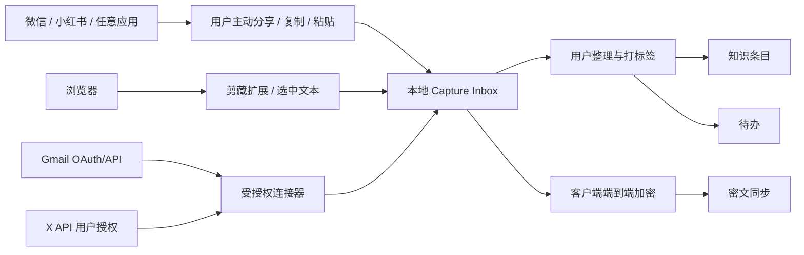

# 外部集成与统一收集方案

**状态：** Proposed per-source plan  
**版本：** 0.1  
**核对日期：** 2026-11-06

## 产品目标

用户希望从微信、X、浏览器、小红书、邮件和其他应用收集内容。Jarvis 不应把“收集”理解成后台读取用户所有账户，而应提供一个统一 Capture Inbox，并让用户选择合适来源与捕获范围。

## 来源能力矩阵

| 来源 | 建议入口 | 初期可交付 | API/权限边界与后备方案 |
|---|---|---|---|
| Gmail | 官方 Gmail API + OAuth | 邮件 triage、摘要、搜索、草稿；按规则做标签/归档 | 读取邮件正文需要敏感/受限范围；发送/修改需更高权限和 Google OAuth 验证评估。首阶段只申请必要范围，逐步启用功能。[Gmail scopes](https://developers.google.com/workspace/gmail/api/auth/scopes) |
| X | 官方 X API v2 用户授权 | 本人书签/点赞的轻量导入和浏览 | X 文档提供本人书签 `/2/users/:id/bookmarks` 与点赞 `/2/users/:id/liked_tweets` 读取路径，需要 approved developer account/app 和 user access token。[Bookmarks](https://docs.x.com/x-api/posts/bookmarks/introduction) [Likes](https://github.com/xdevplatform/docs/blob/main/x-api/posts/likes/introduction) |
| 浏览器 | Chrome/Edge 剪藏扩展 + 网页端快捷保存 | 保存当前 URL、标题和用户选中文字；后续增加明确授权的正文抽取 | 由用户主动点击/选中触发；不请求无关站点的全域权限，不保存网站登录 Cookie。无法抽取正文时保留链接和选中文本。
| 微信 | 系统分享、复制链接/文字、Windows 快捷键捕获 | 先支持用户主动复制到 Jarvis Capture Inbox | 本次检索未确认到读取个人微信收藏、私聊或聊天记录的官方 API。此为公开资料检索结果，不代表平台保证不存在；默认不依赖私有接口、聊天数据库或账号 Cookie。
| 小红书 | 系统分享、复制链接/文字、浏览器剪藏 | 先保存用户选中的链接、标题、文字和来源 | 当前公开开放平台文档重点描述第三方商家商品、订单、库存等接入；本次未发现个人用户收藏/点赞读取接口。因此用主动分享/粘贴作为首发路径。[小红书开放平台简介](https://school.xiaohongshu.com/en/open/quick-start/introduction.html) [API 文档目录](https://school.xiaohongshu.com/en/open/index.html)
| 其他 Windows 应用 | 全局快捷键 + 剪贴板、拖放文件、粘贴到 Capture Inbox | 用户选中内容后快捷收集；文件手动导入 | 快捷键只读取用户主动提交到剪贴板的内容；截图 OCR、附件/文件发给模型前显示明确的数据提示。
| Outlook/其他邮箱 | 对应供应商官方 API 或 IMAP（经用户授权） | 暂不纳入首个完整邮箱连接器 | 先把 Gmail 完整主流程跑通，再对每个服务单独核对 OAuth/API 范围与合规要求。

## X API 费用与可用性

X 当前公开定价文档使用按用量计费：读取按响应返回的资源计费，具体费率可在 Developer Console 查看，并可能变化。当前价格表列出 Like Read 每资源 `$0.001`、Post Read 每资源 `$0.005`，并指出 pay-per-use 计划对每月 Post reads 有上限；不要将这些价格写死在产品中。[X API pricing](https://docs.x.com/x-api/getting-started/pricing)

Jarvis 的同步体验应包含：

- 用户手动启动同步，并能选同步范围/数量。
- 开始前提示当前预计读取量/成本；完成后显示实际读取数和费用状态。
- 页面明确区分已缓存的数据与 X 当前数据；API 限流、权限不足、帖子被删等情况要有说明。
- 每次上线前重新查看 Developer Console 和官方文档，验证当前方案可使用本人书签和点赞端点。

## 统一 Capture Inbox 数据流

统一捕获字段：

- `source_app`：gmail / x / wechat / xiaohongshu / browser / clipboard / file / manual 等。
- `capture_method`：official_api / extension / share / clipboard_hotkey / file_import / manual。
- `source_url`、`title`、`selected_text`、`captured_at`、`user_tags`、`parse_state`。
- `content_scope`：只保存链接、标题、选中片段或完整正文，明确记录用户当时选择的范围。

## 端到端加密与多设备连接器约束

- 所有设备共享同一 Jarvis 账户；邮件/帖子/笔记正文和附件在客户端加密后才进入云同步。
- 服务端必须能识别账户、设备、记录 ID/版本和路由目的，因此可能看到最低限度的同步元数据；内容数据是密文。界面和隐私声明应避免声称服务端“完全不知道任何信息”。
- OAuth refresh token 留在每台授权设备的安全存储中，不进入同步包。密钥丢失后的恢复方法、设备撤销和 token 重新授权须设计清楚。
- 云模型调用时，用户已选定的明文会离开 Jarvis 加密同步边界并发送至模型提供方；请求前明确展示要发送的数据、用途和接收方。
- 如果浏览器版没有获准在本机安全保存 provider token，则由 Windows 桌面客户端作为个人同步节点；在节点离线时显示最近缓存状态，不假装实时同步。

## 集成顺序建议

1. `manual / clipboard / URL / file`：先验证 Capture Inbox 的通用数据模型。
2. Browser clipper：支持 Chrome/Edge 的用户主动捕获，扩展仅请求当前页访问权限。
3. Gmail：先只读，再按功能重新授权草稿、标签/归档与发送范围；Google 桌面应用流程不支持 incremental authorization，不能假设原授权自动扩展。详见 [Gmail 只读设计](GMAIL_READONLY_DESIGN.md)。
4. X：轻量入口，手动同步、范围控制、成本提示。
5. 微信/小红书：先做复制/分享/浏览器捕获；发现官方个人用户 API 后再单独评估。
6. 其他应用：按用户实际使用优先级新增适配器，不把“支持各种应用”误解为全盘扫描。
