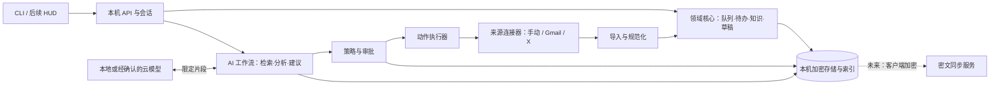

# Jarvis 目标架构：从来源到可信行动

**状态：** 独立建议方案（2026-11-08），不是对现有 FastAPI/SQLite/APSW 选择的预先认可。产品范围见 [产品基线](JARVIS_V2_PRODUCT.md)，落地阶段见 [交付计划](JARVIS_V2_EXECUTION.md)。

## 1. 架构结论

选**设备端模块化单体**作为第一运行形态：一套 Python 领域核心、一个本机数据存储、明确的连接器接口、可替换的模型接口、独立的动作执行器。先用 CLI/HTTP 驱动完整业务闭环，HUD 以后只消费同一份接口。多设备同步是独立信任域，不能因为未来要 Web，就把邮箱令牌和明文内容提前搬到云端。



**控制面与数据面分开：** 模型只接收与本次任务有关的片段，输出结构化建议；连接器令牌只给连接器；策略层决定哪些动作可提议、哪些必须人工确认；执行器只能消费已批准且版本未变的动作。服务端密文同步不拥有邮件令牌和解密密钥。

## 2. 模块边界和稳定合同

| 模块 | 输入 → 输出 | 明确禁止 |
|---|---|---|
| `ingest` | 外部对象/手动捕获 → 规范化 `Artifact` 与来源覆盖记录 | 执行外发、吞掉原始来源信息 |
| `workspace` | Artifact、用户标注 → InboxItem、Todo、Note、Draft | 把 AI 判断直接写成外部事实 |
| `retrieval` | 查询 + 权限上下文 → 带来源版本的证据片段 | 绕过权限读取其他助手/连接器全库 |
| `intelligence` | 证据 + 任务规格 → 结构化 `Suggestion`、模型运行记录 | 拿到 OAuth 令牌、直接调用写接口 |
| `policy` | 用户权限、规则、Suggestion → `ActionProposal` 或拒绝理由 | 把模型文本当系统命令 |
| `approval` | 当前用户、最终载荷、动作版本 → 单次批准/拒绝/过期 | 用旧批准执行改动后的动作 |
| `executor` | 有效批准 → 连接器调用与可核对的结果 | 超时后无条件重试可能重复的外发 |
| `storage` | 事务、索引、备份、恢复 | 密钥错误时回落明文或自动建空库 |
| `sync`（后续） | 设备密文包与版本 → 密文路由/冲突状态 | 服务端解密、模型处理明文 |

用例/领域接口应依赖 Python `Protocol` 或明确的数据对象；存储和连接器为实现细节。保留现有可用服务作为适配器，**不直接把 17 个迁移表改名当新架构**。

## 3. 统一数据模型

“统一”是统一身份、来源和关系，**不是把邮件、帖子和文件挤进一张大表**。

| 实体 | 最小字段 | 原则 |
|---|---|---|
| `ConnectedSource` | id、provider、account_ref、capabilities、granted_scopes、coverage、last_success、status | 权限/覆盖范围可见；令牌只在系统凭据库 |
| `Artifact` | id、source_id、provider_object_id、kind、content_version、content_hash、observed_at、captured_at、visibility | 原始资料稳定标识；同来源去重；版本不覆盖历史证据 |
| `ContentPart` | artifact_id、mime、text/blob_ref、byte_range、language、retention | 正文、附件和选中片段分开；仅保存获准范围 |
| `ProviderState` | artifact_id、provider_revision、labels/read/bookmarked/liked、observed_at | 外部状态快照，不能与 Jarvis 本地标签混淆 |
| `Annotation` | target_id、kind、value、actor、revision | 用户标签/修正独立于来源快照 |
| `Todo` / `Draft` | id、owner、内容、状态、revision、来源边 | 第一类工作对象；可独立编辑，保留派生关系 |
| `EvidenceEdge` | from_id、to_id、source_version、span、relation | 建议、摘要、待办都能回溯到确切来源 |
| `ModelRun` / `Suggestion` | task_type、model_version、prompt_version、input_refs、output、cost、status、evidence | AI 输出可重算、可拒绝、可评估；不伪装为事实 |
| `ActionProposal` / `Approval` / `ExecutionReceipt` | action、account、target、payload_hash、revision、expires_at、approver、provider_result | 提议、用户决定和外部结果分别存储；结果不明确单独标记 |
| `Job` / `SyncCursor` | kind、scope、cursor、retry_after、attempts、status | 可中断续做；游标只有在整批持久化后推进 |
| `AuditEvent` | actor、event、object_ref、result、time | 最小元数据；完整性另行设计，不存正文/密钥 |

本地索引从 Artifact/ContentPart 派生；来源撤权、删除或内容更新时使相关索引和建议失效。R0 用固定虚构标识和版本测试这一语义。R1 之前做迁移与旧数据适配策略，绝不直接把合成库升级成真实库。

## 4. AI 算法设计

### 4.1 可测的流水线

1. **预处理：** 结构化提取发件人、主题、正文、引用、签名、时间与来源 ID；只做可解释的规则与清洗。HTML/帖子文本是不可信数据。
2. **候选检索：** 先用字段过滤和全文检索找相关片段；索引只含当前助手和当前来源获准内容。向量检索是后续实验，只有在已标注查询集上显著改善召回才引入。
3. **任务模型：** 分开运行“是否需处理”“摘要”“待办/承诺抽取”“回复草稿”四类任务，不让一个长提示同时决定所有动作。输出必须过 schema、长度、来源引用和敏感字段检查。
4. **证据核对：** 摘要与任务候选绑定原文 span 或消息 ID；无法找到支持片段时标为待核，不凭模型自称的 confidence 放行。
5. **用户反馈：** 接受、编辑、拒绝、误报/漏报进入本地评测记录；真实内容不自动进入训练集或云端遥测。

模型可用本地或云端实现。云调用前展示接收方、目的、输入片段与预计费用；只发送用户确认的必要内容。R0 可以继续用假模型验证流程，但**不能用假模型的 PASS 表示 AI 效果达标**。

### 4.2 评价协议

- 建一个至少覆盖普通邮件、长线程、引用/签名噪声、模糊承诺、时区、重复来源、恶意提示注入和无行动内容的**合成标注集**；按来源隔离训练/评测样本。
- 记录分类 precision/recall、待办抽取漏检、摘要事实支持率、错误来源引用率、结构化输出失败率、拒答率、人工修改率、耗时与成本。阈值在基线样本上确定并版本化。
- 做规则基线、模型基线和“规则 + 模型 + 证据校验”对照；每次改提示或模型重跑同一套样本，记录差异。对真实用户样本的评测只能在用户明确同意且本地保护达标后进行。

### 4.3 记忆与个性化

Jarvis 当前只需要任务偏好和用户确认的持久事实，例如重要联系人规则、常用项目、明确设定的提醒习惯；不把所有邮件摘要自动变成长期记忆。每条记忆有来源、范围、更新时间、可撤销状态。陪伴模式的连续性需求冻结，继续维持隔离。

## 5. 动作状态机与外部失败

`proposed → previewed → approved → executing → succeeded | failed | outcome_unknown`；内容或目标版本变化则 `invalidated`，超时则 `expired`。批准由可信本机会话产生，绑定账号、动作、目标、最终 payload hash、版本和短有效期。

执行器必须持有一次性使用记录，并在调用后保存 provider receipt。对 Gmail 发送这类无法保证恰好一次的动作，网络超时先进入 `outcome_unknown`，查询服务端状态或请用户核对后才允许重试；不能因为本地没有收到成功响应就再次发送。低风险本地整理使用幂等键和可逆前像。删除/发帖/对外私信一直逐项确认。

## 6. 技术栈与替代方案

| 层 | 建议 | 选择理由与保留选项 |
|---|---|---|
| 核心语言 | Python 3.13/3.14 **选择一个经锁定且有稳定依赖的版本** | 团队现有能力、AI 与连接器生态；不要继续让三个解释器代表同一产品环境。性能热点经测量后再用 C++ |
| 领域与 API | Python 模块化单体；FastAPI 仅作薄 HTTP 边界，Pydantic 只管输入/输出 | 当前代码可迁移；CLI 与 UI 共用用例，不让路由直接承载业务。不开微服务/通用 Agent 框架 |
| 数据库 | SQLite 本地事务 + FTS5；**加密实现待候选评审** | 单用户设备端足够；APSW/SQLite3MC 和 SQLCipher 都按来源、许可、API 语义、性能与恢复验收选，不因现有投入锁定 |
| 任务运行 | 持久化 `Job` 表 + 单设备受控 worker；定时任务仅触发 worker | 可恢复和可观察；现阶段无须 Celery/消息总线 |
| 模型 | 可替换 provider 接口 + 版本化任务规格；先离线评测再选本地/云模型 | 防止供应商与提示耦合；不预设某模型能胜任真实邮箱 |
| 前端 | 领域 API 稳定后 React + TypeScript + Vite 实现原创 HUD | 可渐进学习、共享 Web 组件；桌面封装和网站密钥安全分别评估，不立即选 Tauri/Electron |
| 同步服务 | 后续独立的身份/密文存取服务 | 先设计设备加入、撤销、冲突、浏览器脚本信任和恢复；不能直接复用本机 bearer token |

## 7. 真实连接器的边界

- **Gmail：**读取正文需要 `gmail.readonly` 等受限 scope；标签/归档常需 `gmail.modify`，该 scope 还允许发送，所以**应用自己的动作策略必须额外阻断未经审批的发送**。桌面 OAuth 用系统浏览器、PKCE 和 loopback；已安装应用不支持增量授权，后续扩权须重新设计授权体验。首次同步和 `history.list` 增量同步要处理游标过期的 404 回退。公开发布与受限数据使用可能引入验证/安全评估，不能等到上线前才发现。来源：[Google Gmail scopes](https://developers.google.com/workspace/gmail/api/auth/scopes)、[桌面 OAuth](https://developers.google.com/identity/protocols/oauth2/native-app)、[同步指南](https://developers.google.com/workspace/gmail/api/guides/sync)。
- **X：**官方文档列出本人书签和点赞帖文读取端点；正式可用性、授权范围、速率和费用须在开发者控制台实际核验。先手动同步、有限数量和花费上限；断开时保留已允许的本地副本并标记新鲜度。来源：[书签](https://docs.x.com/x-api/posts/bookmarks/introduction)、[点赞](https://docs.x.com/x-api/posts/likes/introduction)、[计费](https://docs.x.com/x-api/getting-started/pricing)。
- **微信与小红书：**以用户主动分享、复制、网页剪藏为默认入口；个人消息历史、代聊或点赞/收藏读取在适用且获准的接口被证实之前只列为研究项。不接受账号密码、Cookie 或私有数据库作为连接器。

## 8. 安全、备份与多设备

R0 的 `synthetic` 开关只能标记测试意图，不能识别个人内容。R1 的真实资料入口必须是独立构建/配置、经审核的存储与身份边界；密钥错误拒绝启动，不回落明文。备份要能在原机丢失的假设下恢复，保留数量与锁期对账。审计记录需要完整性方案；本机 API 需可信会话，不能只依赖长寿命环境 bearer token。

端到端同步要单独评审：服务器可见账号、设备、对象大小和时间等元数据；浏览器端仍依赖部署脚本的可信性；离线设备的删除、撤权和冲突不能靠“云端只存密文”自动解决。同步与语音不应阻塞 R0 的 AI 质量和领域闭环验证。

## 9. 建议的仓库结构与迁移方式

```text
backend/
  jarvis/
    domain/          # Artifact、Todo、Draft、Suggestion、Action 的纯业务规则
    usecases/        # 导入、分流、提议、审批、执行、撤权等纵向流程
    ports/           # Storage、Connector、Model、Clock、Identity 合同
    adapters/        # sqlite、假来源、Gmail、X、模型实现；按阶段加入
    api/             # 薄 HTTP 路由；不写业务 SQL
    jobs/            # 持久化同步/评测/维护作业
  evaluation/        # 虚构标注样本、评分器、版本化报告
  migrations/        # 数据版本与迁移；保持旧库证据
  verification/      # 快速必跑、集成、故障、安全研究分组
frontend/            # HUD 接口稳定后再建
docs/                # 产品、架构、决策、阶段证据
```

这是**目标边界，不是要求立即搬文件**。M1 先把一个闭环放进 `usecases/` 并以端口适配现有 `backend/app/services/synthetic_*`；现有 17 个迁移和合成检查保持可运行。每迁移一个用例都对比旧行为、来源追踪、审批语义与事务结果。只有新的合同和评测稳定后，才清理旧服务或拆分 388 行的 `jarvis_routes.py`；避免一次性重写让已知正确性证据失效。
